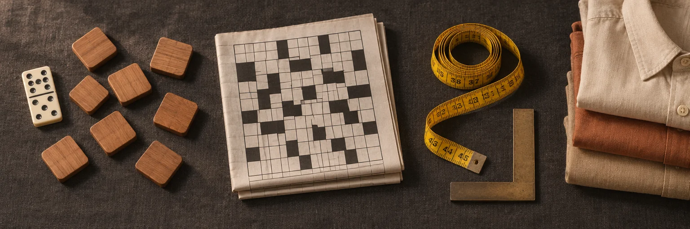

# Hi, I'm Jackee 👋

**I build small, focused web tools — and open-source the useful parts.**

---

## 🌐 Sites I run

| | Site | What it does |
| :--- | :--- | :--- |
| 🎮 | **[24pointgame.com](https://24pointgame.com)** | The classic 24-point math game — play online, instant solver, printable puzzle worksheets for teachers |
| 🧩 | **[amazingcrossword.com](https://amazingcrossword.com)** | AI crossword generator built for K-12 / ESL classrooms |
| 📏 | **[pslrange.com](https://pslrange.com)** | Free AI PSL test — photo ratings on the 1.0–8.0 scale with stable multi-photo ranges |
| 🎬 | **[wavememe.com](https://wavememe.com)** | Drop your face into trending meme video templates |
| 👕 | **[xxxxlsizes.com](https://xxxxlsizes.com)** | Big & tall size chart lookup — what "XXXXL" actually measures across brands |

## 🔓 Open source from these projects

- 📊 **[plus-size-size-chart](https://github.com/imj0cky/plus-size-size-chart)** — machine-readable big & tall size chart dataset (JSON)
- 🔢 **[24-point-game-solver](https://github.com/imj0cky/24-point-game-solver)** — a fast 24-point solver with fraction support

---

📫 Reach me through any of the sites above.

